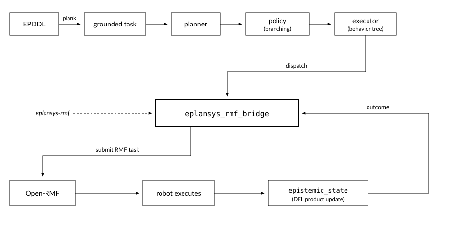

Open-RMF execution
==================

``eplansys_rmf_bridge`` executes epistemic policies on a robot fleet managed by
Open-RMF :cite:p:`openrmf`. It is an ``ActionExecutorClient``: it accepts a
dispatched action, submits the corresponding RMF task, waits for completion,
and calls ``finish()`` with the outcome the robot observed, which the policy
branches on (:ref:`arch-observation`).

The bridge is maintained in a separate repository,
`eplansys-rmf <https://github.com/ePlanSys/eplansys-rmf>`_, so that
installations without a fleet do not depend on Open-RMF. The same arrangement
applies to the external planner binary of ``plansys2_aletheia_plan_solver``.

.. _fig-rmf-pipeline:

         executor dispatches an action to eplansys_rmf_bridge, which submits an
         RMF task; the robot executes it and the observation returns as an
         outcome that updates the epistemic state.

   Position of the bridge between the policy and the fleet.

The bridge is the only component that both dispatches into the fleet and
receives the fleet's observations (:numref:`fig-rmf-pipeline`). Components
above it belong to the planning stack, components below it to Open-RMF. The
``outcome`` edge carries observations back into the epistemic state; without
it the bridge would only issue commands.

Division of responsibility
--------------------------

Open-RMF has no representation of knowledge; ePlanSys has no representation of
shared physical resources.

.. list-table:: Decisions made by each system.
   :header-rows: 1
   :widths: 22 78

   * - System
     - Determines
   * - ePlanSys
     - what must be found out, which agent acts, and which agents may learn
       the result
   * - Open-RMF
     - allocation of floor space, lifts and doors; robot availability

Performers
----------

The bridge creates one performer per action in its task map
(:doc:`task_map`). On dispatch, a performer behaves according to its entry:

* A movement action submits an RMF task pinned to the robot bound to the
  acting agent, waits for completion, and finishes.
* A ``local`` action is a speech act: no task is submitted, and the performer
  finishes after its declared duration. Its epistemic effect is computed by the
  epistemic state.
* A ``sensing`` action finishes with an outcome token, on which the policy
  branches.

Reference scenario
------------------

The site survey (:doc:`../demos/survey`): three agents, a site that may be
contaminated, and a goal requiring that ``scout`` and ``relay`` learn the
finding and ``observer`` does not. The planner selects the private channel,
since a broadcast would falsify the third conjunct. :doc:`demo` runs this
mission over an RMF fleet.

.. toctree::
   :maxdepth: 1

   decisions
   task_map
   demo
   warehouse
   diagnostics
   building
