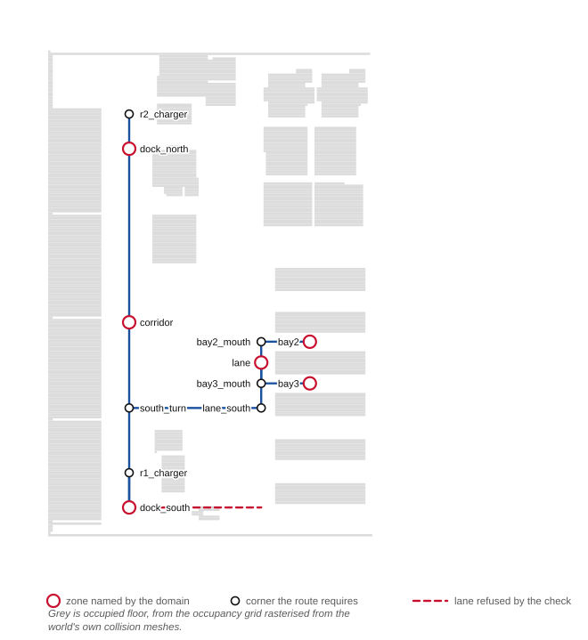
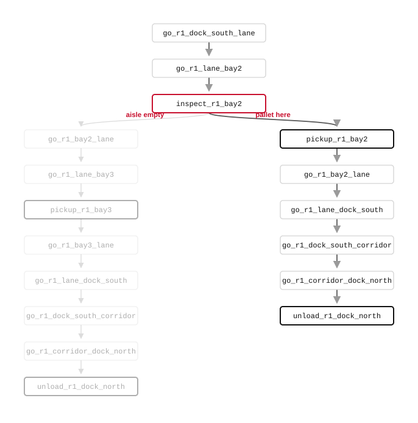
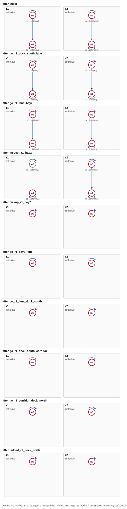
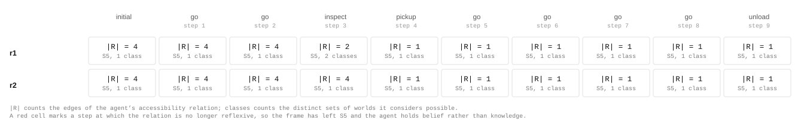
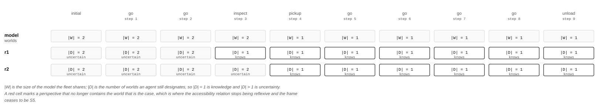

Warehouse run
=============

A larger bridge deployment than :doc:`demo`: two robots in an AWS warehouse, a
pallet in one of two bays, and a policy that inspects before committing. It
exercises the task-map fields the survey leaves at their defaults, and the
figures show the epistemic state along an execution in which Open-RMF moves
the robot.

``warehouse_rmf_demo`` is in the `Epistemic-Robotics
<https://github.com/HanielUlises/Epistemic-Robotics>`_ repository under
``ros2_ws/src``, together with a hotel scenario of the same construction. This
chapter documents only its use of the bridge.

Floor and nav graph
-------------------

Open-RMF navigates a nav graph; the domain names zones. The graph is generated
from the source the domain is written against and checked against the
occupancy grid (:numref:`fig-wh-floor`).

.. _fig-wh-floor:

         domain are ringed; intermediate corners carry the route; one lane is
         refused because it crosses occupied floor.

   Nav graph over the occupancy grid; one lane is refused by the check.

``dock_south``, ``corridor``, ``dock_north``, ``lane``, ``bay2`` and ``bay3``
are domain zones. ``bay2_mouth``, ``south_turn`` and the chargers are
intermediate vertices required by the routes. A lane crossing occupied cells is
refused by the generator.

Task map
--------

Destinations are taken from the actions' arguments, so a few entries cover a
domain whose actions name zones:

.. code-block:: json

   {
     "zones": {
       "dock_south": "dock_south", "corridor": "corridor",
       "dock_north": "dock_north", "lane": "lane",
       "bay2": "bay2", "bay3": "bay3"
     },
     "agents": {
       "r1": {"fleet": "warehouseBot", "robot": "r1"},
       "r2": {"fleet": "warehouseBot", "robot": "r2"}
     },
     "actions": {
       "goto_zone": {"waypoint_arg": 2},
       "look_into": {
         "waypoint_arg": 1,
         "sensing": true,
         "outcome_arg": 1,
         "outcomes": {"bay2": "e-inspect-found", "bay3": "e-inspect-empty"},
         "default_outcome": "e-inspect-empty"
       },
       "pick_up":  {"waypoint_arg": 1},
       "drop_off": {"waypoint_arg": 1},
       "announce": {"local": true, "duration": 4.0}
     }
   }

``(goto_zone r1 lane bay2)`` sends ``r1`` to ``bay2`` (argument 2).
``look_into`` is the sensing action; its ``outcomes`` table is the simulated
ground truth (the pallet is in ``bay2``). A fleet that reports a real
observation overrides it, and ``default_outcome`` applies, with a warning, when
nothing is reported.

The ``zones`` table is the identity, since the graph generator uses the
domain's names; it is stated explicitly so that the correspondence is checked.

The bridge is launched as a node with the map, the adapter's port, and a
timeout of 900 s (default 120 s), as warehouse traverses under traffic
management are long:

.. code-block:: python

   Node(package='eplansys_rmf_bridge',
        executable='rmf_action_node',
        parameters=[{'task_map': map_file.name,
                     'websocket_port': WEBSOCKET_PORT,
                     'task_timeout': 900.0}])

Policy
------

The pallet's bay is unknown, so the policy branches at the inspection
(:numref:`fig-wh-policy`).

.. _fig-wh-policy:

         the pallet is present and the case where the aisle is empty, each
         ending in an unload at the north dock.

   One sensing action, two branches, both ending at the north dock.

The prefix up to ``inspect_r1_bay2`` is shared. The two branches differ in the
bay where the pallet is picked up and both end at ``dock_north``. The token
the bridge extracts from the RMF task state selects the branch:
``e-inspect-found`` picks up at ``bay2``, ``e-inspect-empty`` continues to
``bay3``.

Epistemic state along the run
-----------------------------

The state applies a product update after every action, including those that
change no agent's knowledge (:numref:`fig-wh-kripke`).

.. _fig-wh-kripke:

         drive actions and collapse to one at the inspect, after which both
         robots consider a single world possible.

   The Kripke model after each action, for both robots.

Both worlds survive every movement action. The model contracts at
``inspect_r1_bay2`` only, and asymmetrically: ``r1`` senses and ``r2`` does
not. The outcome must therefore be reported by the fleet; it cannot be
assumed.

.. _fig-wh-frames:

         at each step, for both robots.

   Size and classes of each agent's accessibility relation at each step.

In :numref:`fig-wh-frames`, ``|R|`` is the size of an agent's accessibility
relation and the classes column the number of distinct successor sets. A frame
that ceases to be reflexive has left S5; from that step the agent holds belief,
and the change should be deliberate.

Trajectory
----------

   Driven trajectory over the floor plan.

Open-RMF executed the motion, including traffic management, lanes, doors and
lifts. The bridge overrides only allocation, so that the agent the model
credits with knowledge is the robot that sensed.
